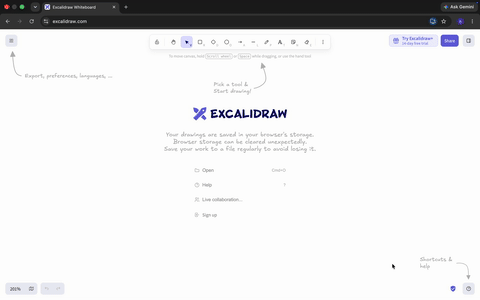

# strome
Browser where each tab is isolated (incognito). Useful for multi-account sites.



## Build (macOS)
Requires Xcode CLT, `cmake`, `curl`, `tar`.

```bash
git clone git@github.com:haibeey/strome.git
cd strome
./install.sh
./build/src/Release/strome.app/Contents/MacOS/strome
```
`install.sh` downloads the correct CEF and builds a Release app for your arch.

## Releases
Download the DMG for your arch from [Releases](https://github.com/haibeey/strome/releases). Unsigned builds may be blocked by Gatekeeper:

```bash
xattr -cr /Applications/strome.app
codesign --force --sign - /Applications/strome.app
/Applications/strome.app/Contents/MacOS/strome
```
